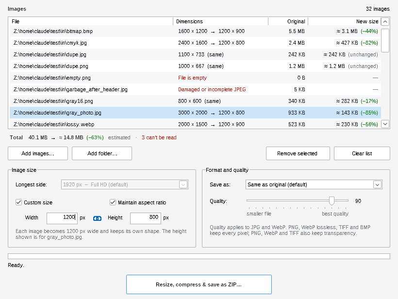
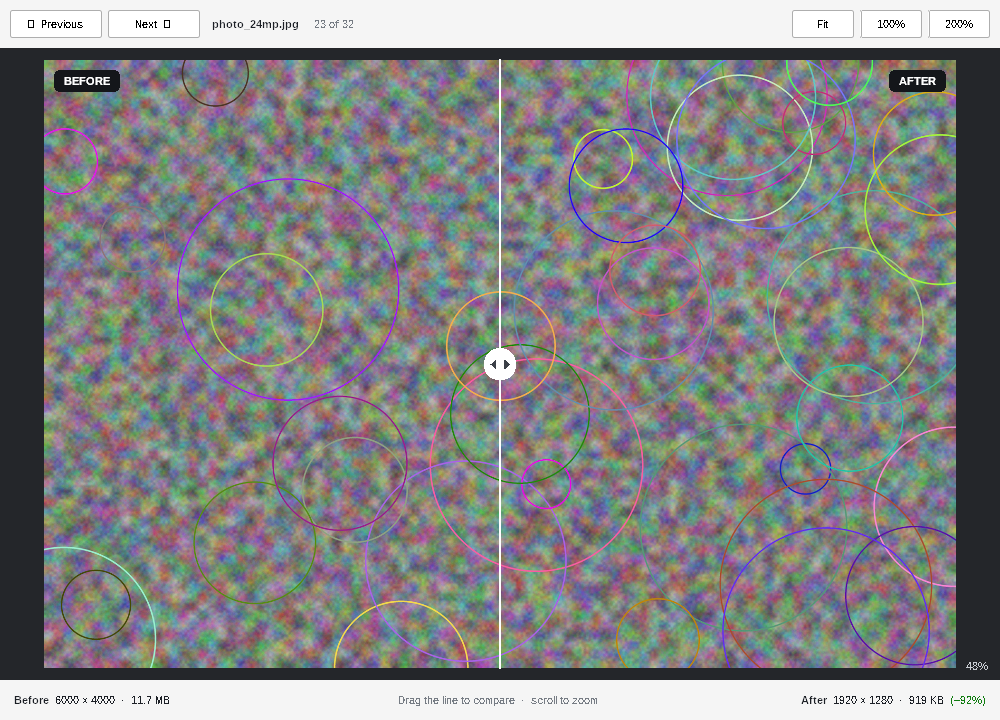

<p align="center"></p>

<h1 align="center">Image Shrinker</h1>

<p align="center">Bulk-resize and compress images on Windows and get them back in one zip.<br>
A single 1.7 MB exe: no installer, no runtime, and it keeps itself up to date.</p>

<p align="center"></p>

## Download

Get **`ImageShrinker.exe`** from the [latest release](../../releases/latest) and run it.
The app isn't code-signed, so the first time Windows shows *"Windows protected your PC"*: click **More info → Run anyway**.

## What it does

- **Add images**: drag files or whole folders onto the window, or use *Add images… / Add folder…*. Reads JPG, PNG, WebP, BMP and GIF.
- **Pick which ones**: every image has a checkbox (all ticked by default). Only ticked images are compressed and saved. Click the box in the header to tick or untick everything, or select rows and press Space.
- **See before you save**: each file shows its dimensions, current size and estimated new size, with the change in green (smaller) or red (bigger), plus a running total.
- **Size**: shrink the longest side to a preset (default 1920 px), or tick *Custom size* to set a width and/or height. With *Maintain aspect ratio* on, typing one fills in the other (for the selected image) and every image keeps its shape. With it off, images are set to exactly that width × height.
- **Format**: keep each image's own format, or convert all to JPG, JPEG, PNG, WebP, WebP lossless, TIFF or BMP. The quality slider (default 90) applies to JPG and WebP.
- **Step 1 · Resize and compress**: makes the new versions without saving anything yet. Change the settings and run it again as often as you like. Each run starts from your **original** files, never from an earlier result.
- **Preview**: double-click an image (or select it and click *Preview*). Once it's compressed you get a before/after view: drag the line to compare, scroll to zoom, and use ‹ › to step through the selected images.
- **Step 2 · Save**: appears after compressing. Save **to a folder** (default) or **as a zip file**. Existing files are never overwritten; a name that's already taken gets " (2)" added.
- Photos are rotated upright, camera metadata is removed, wide-gamut colour profiles are kept, and re-saving never makes an image larger.
- **Light on resources**: one image in memory at a time, low-priority background threads, and results kept in a temporary folder that's removed when you close the app.

<p align="center"></p>

## Updates

When the app starts it checks this repository's latest release. If there's a newer version, it downloads it, checks it against the SHA-256 checksum GitHub publishes for the file, and installs it when you close the app (or right away with *Restart now*).

### Publishing a new version

1. Push your changes to `main`.
2. Open the **Actions** tab → **New release** → **Run workflow**.
3. Pick the bump and click **Run workflow**:
   - **patch** — small fixes: `1.3.0 → 1.3.1`
   - **minor** — new features: `1.3.0 → 1.4.0`
   - **major** — big changes: `1.3.0 → 2.0.0`

   Optionally type a few words for *What's new*; a list of the changes since the last release is added automatically. Tick *Dry run* to see the next version number and test the build without publishing anything.

The workflow finds the latest `vX.Y.Z` tag, works out the next version, builds `ImageShrinker.exe` with that version number and publishes the release with the exe attached (about 2 minutes). The very first run uses the version already in the code (`APP_VERSION` in `src/gui.c`) instead of bumping.

Every installed copy picks up the new release the next time it starts.

You can still publish a release by hand on the **Releases** page (tag like `v1.4.0`); the *Build and release* workflow then builds the exe and attaches it.

## Building it yourself

From Linux or macOS (or WSL) with Python 3 and git:

```sh
pip install ziglang==0.17.1      # the C compiler used to target Windows
scripts/fetch_deps.sh            # downloads the pinned libraries into deps/
scripts/build.sh 1.3.0           # -> out/ImageShrinker.exe
```

| Path | What's in it |
|---|---|
| `src/gui.c` | Window, file list, options, background threads |
| `src/core.c` | Decode → resize → encode pipeline, size estimates, preview decoding |
| `src/update.c` | Self-update from GitHub Releases |
| `src/preview.c` | Preview window with before/after comparison |
| `src/zipw.c` | Zip writer |
| `src/test_cli.c`, `src/test_est.c` | Command-line test tools for the pipeline |

Third-party libraries and their licenses: [THIRD_PARTY_NOTICES.md](THIRD_PARTY_NOTICES.md).
